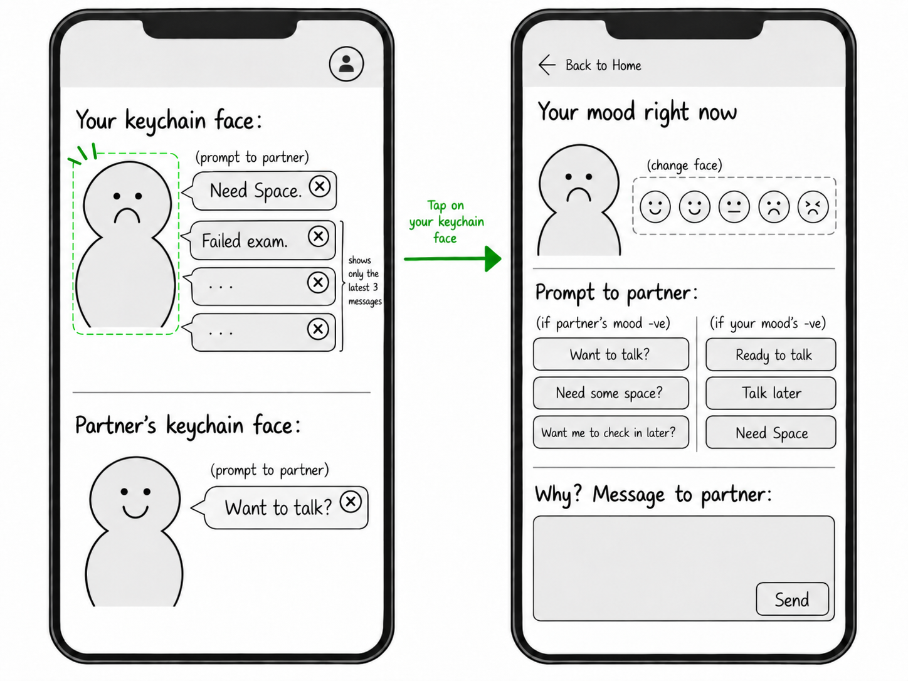
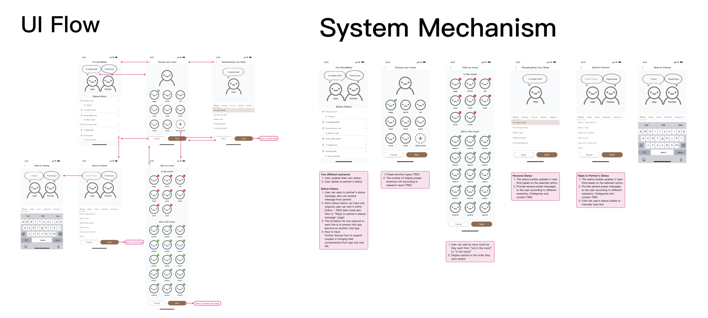
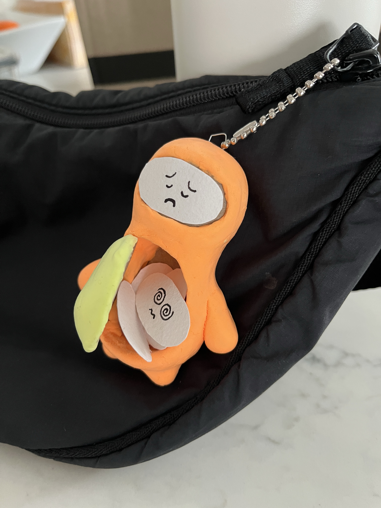
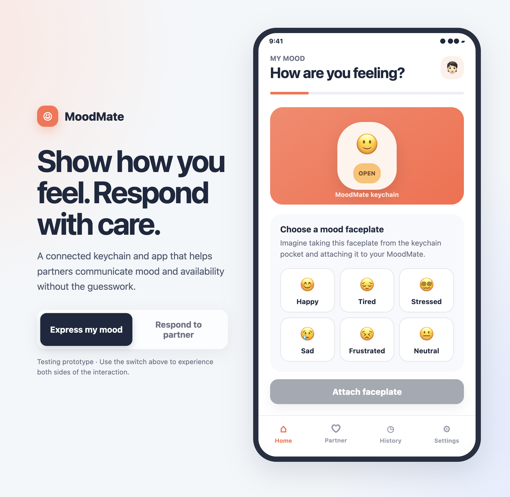
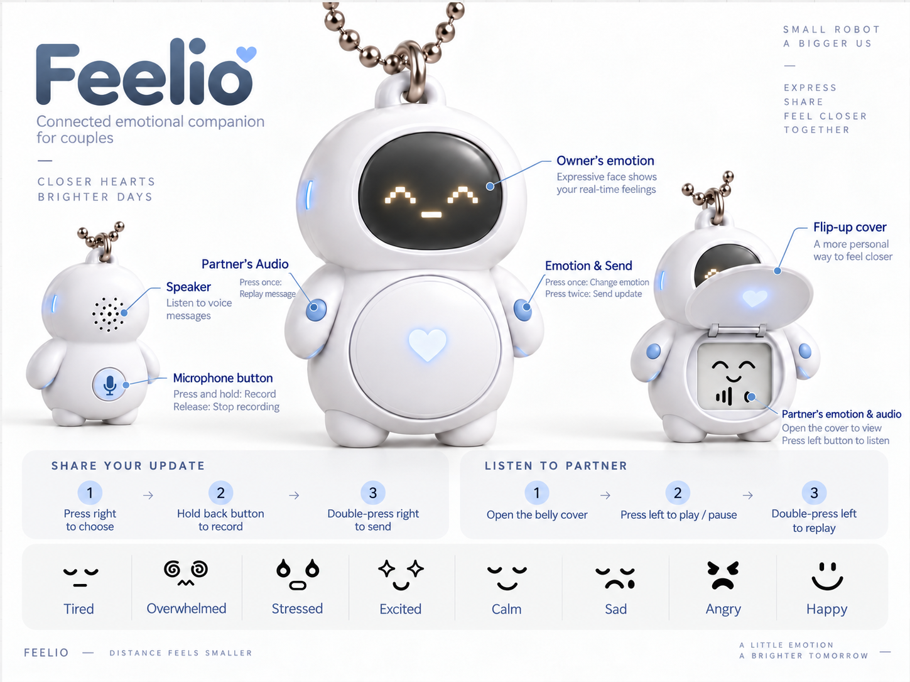
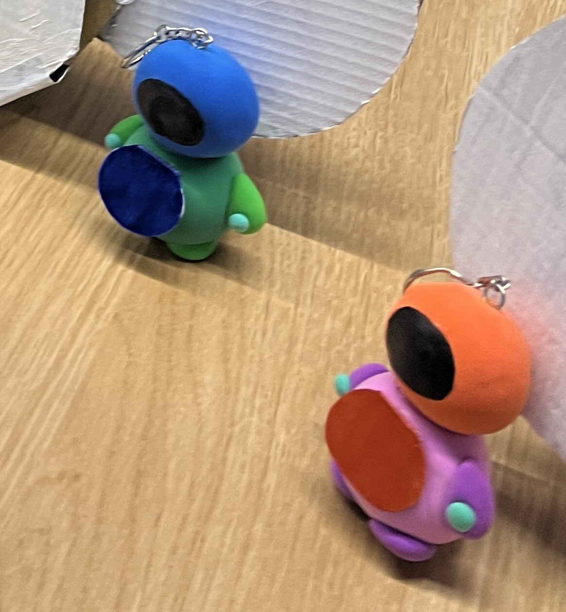
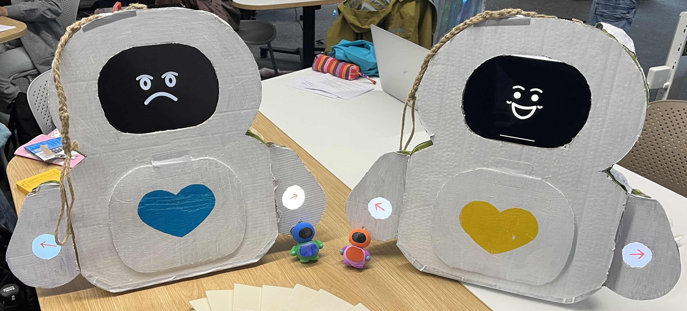

# Prototype Iterations

## 1. Initial wireframe

Early app wireframes explored how partners could share their mood, communicate their needs, and respond to each other.

## 2. App and keychain prototypes

An app flow for selecting moods and exchanging messages was paired with a physical keychain prototype with interchangeable emotion faceplates.

## 3. App iteration

The MoodMate app refined mood selection and partner responses, linking the app interaction to the keychain's emotion faceplates.

## 4. Bag charm-only concept

Feelio moved the interaction entirely onto the bag charm, with emotion displays, physical controls, a flip-up belly cover, and a voice messaging concept.

## 5. Physical and functional prototypes

Small physical bag charms and a larger functional prototype demonstrated emotion sharing and preset message exchanges without voice recording.

